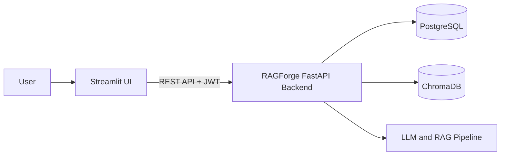

# RAGForge UI

An optional Streamlit-based user interface for [RAGForge](https://github.com/mehmood22/ragforge), an open-source backend for Retrieval-Augmented Generation (RAG) and conversational document Q&A.

This project provides a lightweight visual interface for interacting with the RAGForge REST APIs without duplicating backend business logic.

## Features

- User registration, authentication, and session management
- PDF upload and asynchronous ingestion status monitoring
- Document management and indexing status
- Conversational document Q&A with persistent backend history
- Context-aware follow-up questions
- Page-level source citations
- Semantic search with configurable Top K
- Single-question grounded Q&A
- Explicit insufficient-context handling
- Configurable backend API URL

## Technology Stack

- Python
- Streamlit
- Requests
- RAGForge REST API
- JWT authentication

## Architecture



The Streamlit application acts as a thin API client. Authentication, document processing, retrieval, conversation persistence, and answer generation are handled by the RAGForge backend.

## Prerequisites

- Python 3.12 recommended
- A running RAGForge backend
- Git

## Getting Started

### 1. Start the backend

Follow the setup instructions in the [RAGForge backend repository](https://github.com/mehmood22/ragforge).

The default backend API URL is:

`http://localhost:8000/api/v1`

### 2. Clone this repository

```bash
git clone https://github.com/mehmood22/ragforge-ui.git
cd ragforge-ui
```

### 3. Create a virtual environment

```bash
python -m venv .venv
```

Windows PowerShell:

```powershell
.\.venv\Scripts\Activate.ps1
```

Linux/macOS:

```bash
source .venv/bin/activate
```

### 4. Install dependencies

```bash
python -m pip install -r requirements.txt
```

### 5. Run the application

```bash
python -m streamlit run app.py
```

Open `http://localhost:8501` in your browser.

## Configuration

The backend URL can be configured using the `RAGFORGE_API_URL` environment variable.

Windows PowerShell:

```powershell
$env:RAGFORGE_API_URL="http://localhost:8000/api/v1"
python -m streamlit run app.py
```

Linux/macOS:

```bash
RAGFORGE_API_URL=http://localhost:8000/api/v1 python -m streamlit run app.py
```

## Usage

1. Register or sign in.
2. Upload a text-based PDF.
3. Wait for document indexing to complete.
4. Start a conversation and select the indexed document.
5. Ask questions and inspect supporting source citations.
6. Use the Search & Q&A tab for semantic retrieval or standalone questions.

## Project Status

This is an early, local-first demonstration client for RAGForge. It is not a standalone RAG engine or a hosted commercial service.

A running RAGForge backend is required.

## Related Project

[RAGForge — Open-source AI backend](https://github.com/mehmood22/ragforge)

## License

MIT License.

Technical feedback, issue reports, and contributions are welcome.